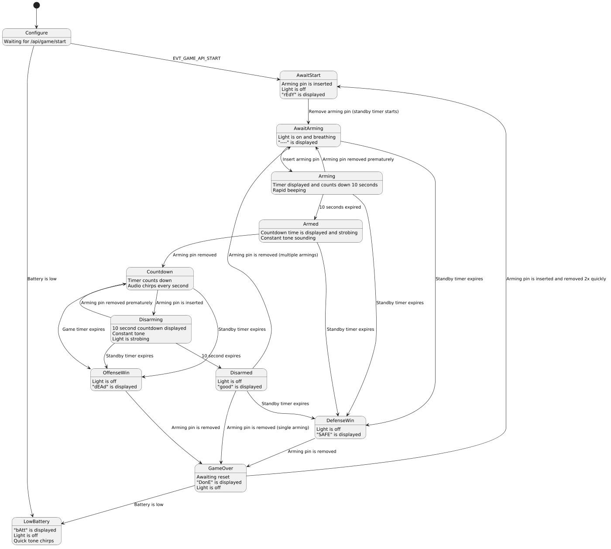

# Bio-Vial Milsim Prop Firmware and Web UI

This repository contains the Bio-Vial standalone prop firmware and its browser-based Game and System/Admin interfaces.

For operating instructions aimed at airsoft players and field referees, see the [Bio-Vial User Manual](doc/USER_MANUAL.md).

The current default firmware target is an ESP8266 D1 Mini using the Arduino framework, LittleFS, `ESPAsyncWebServer`, and HFSM-based game/network state machines. The code also keeps ESP32 compatibility paths where supported.

## Project Structure

```
.
├── data/                  # LittleFS filesystem image contents
│   ├── filesystem.json    # Manifest used by system file endpoints
│   ├── game_defaults.json # Saved/default game settings
│   ├── network.json       # WiFi and device/mesh configuration
│   └── web/
│       ├── game/          # Compiled game UI served in game mode
│       ├── shared/        # Shared static assets
│       └── system/        # Compiled system/admin UI served in admin mode
├── dist/                  # Webpack build output (copied to data/web/ by Grunt)
├── doc/                   # Project documentation
├── include/               # Firmware headers
├── scripts/               # PlatformIO helper scripts
├── src/                   # Firmware source code
├── web/                   # React source code
│   ├── game/              # Game interface React app
│   ├── shared/            # Shared web assets
│   └── system/            # System/admin interface React app
├── Gruntfile.js           # Web build/copy/gzip automation
├── package.json           # Node.js dependencies and scripts
├── platformio.ini         # Firmware build environments
├── proxy-server.js        # Local web/API development proxy
└── webpack.config.js      # Webpack configuration
```

## Setup

### 1. Install Node.js Dependencies

```bash
npm install
```

### 2. Build React Applications

Build both applications and deploy them to `data/web/`:

```bash
npm run build
```

Or use Grunt directly:

```bash
grunt build
```

This will:

- compile the React applications with Webpack
- copy the Game UI to `data/web/game/`
- copy the System/Admin UI to `data/web/system/`
- copy shared assets to `data/web/shared/`
- gzip compress `.js`, `.css`, `.html`, `.txt`, and `.json` files
- delete the original uncompressed files after gzip compression

### 3. Gzip Compression

Run gzip compression separately if needed:

```bash
npm run gzip
```

This compresses eligible files under `data/web/` and replaces them with `.gz` files.

### 4. Build Individual Apps

Build only the game interface:

```bash
grunt build-game
```

Build only the system/admin interface:

```bash
grunt build-system
```

Individual app builds copy the selected app and shared assets into `data/web/`. They do not run the full clean/gzip pipeline unless you run `grunt build` / `npm run build`.

### 5. Watch for Changes

Automatically rebuild changed web source files:

```bash
npm run watch
```

### 6. Build and Upload Firmware

The PlatformIO environment is `esp8266dev` for a WeMos D1 Mini-style ESP8266 board, and it is the only environment defined.

Build firmware:

```bash
platformio run
```

Upload the LittleFS filesystem image:

```bash
platformio run --target uploadfs
```

Upload firmware:

```bash
platformio run --target upload
```

Open the serial monitor at `115200` baud:

```bash
platformio device monitor
```

## Prop Operation

### Boot and Mode Selection

On boot, the firmware mounts LittleFS, loads `/network.json`, starts the networking and game FSMs, then chooses a network/UI mode:

- if `/network.json` is missing or invalid, the prop immediately enters **admin mode**
- otherwise, inserting the arming/disarming pin during the first 5 seconds enters **admin mode**
- if the pin is not inserted during that 5-second window, the prop enters **game mode**

### Admin Mode

Admin mode is for setup, recovery, diagnostics, and lifting/restoring files on the filesystem.

- AP SSID: `BrooklynTactical-<chip-suffix>`
- Password: none; the admin AP is open by design for recovery
- UI: System/Admin interface at `http://my.milsim.prop/`
- fallback IP: `http://4.3.2.1/`

Admin mode intentionally ignores the saved SSID/password so a bad config cannot lock out the operator.

### Game Mode

Game mode is normal field operation.

- AP SSID/password/channel come from `/network.json`
- fallback SSID/password/channel are `BrooklynTactical`, `password`, and channel `1`
- UI: Game interface at `http://my.milsim.prop/`
- fallback IP: `http://4.3.2.1/`

### Game Flow



The game is controlled by the web API/UI and the arming pin. The main game FSM flow is:

```text
configure -> await_start -> await_arming -> arming -> armed -> countdown
```

From `countdown`:

- inserting the pin starts `disarming`
- completing the disarm moves to `disarmed`
- timer expiry moves to `released`
- final pin removal moves to `gameover`

If multiple armings are enabled, a successful disarm can return to `await_arming` instead of ending the round. A critical low-battery event can move the game to the terminal `lowbattery` state.
 
### Demo Routine

The demo is a scripted display, speaker and LED sequence for testing the prop. It is started from the **Diagnostics** page of the System/Admin UI (**Run Demo**).
The demo code is separate from the real game states, so running it does not change game behaviour.

### Serial Terminal

The serial terminal runs at `115200` baud and supports EEPROM setup commands for hardware revision and battery calibration.

See `doc/Serial_Terminal.md` for the current command list and EEPROM layout.

## React Applications

### Game Interface (`web/game`)

- displays current game state and configured timing values
- starts the game with countdown/arm-disarm/standby settings
- reads and writes saved game defaults
- integrates with `/api/game/*` endpoints

**Access in game mode:** `http://my.milsim.prop/` or `http://4.3.2.1/`

### System Interface (`web/system`)

- displays device information and system status
- configures game-mode WiFi and device/mesh metadata
- exposes file lift/restore operations
- provides diagnostics for LED, display, speaker, demo routine, arm-status, and EEPROM endpoints
- integrates with `/api/system/*` endpoints

**Access in admin mode:** `http://my.milsim.prop/` or `http://4.3.2.1/`

## API Endpoints

### Shared API

- `GET /api/versions` - hardware, firmware, and filesystem version info
- `GET /api/battery` - current calculated battery percentage

### Game API

- `GET /api/game/state` - current game FSM state and active game settings
- `POST|PUT /api/game/start` - apply game settings, reset runtime state, and start the game
- `GET /api/game/defaults` - read `/game_defaults.json`
- `POST|PUT /api/game/defaults` - write `/game_defaults.json`

### System API

- `GET /api/system/info` - device/chip information
- `GET /api/system/status` - uptime and heap/status information
- `POST /api/system/restart` - restart the device
- `GET /api/system/wifi` - read saved game-mode WiFi settings
- `POST|PUT /api/system/wifi` - update saved game-mode WiFi settings in `/network.json`
- `GET /api/system/mesh` - read saved net/device metadata
- `POST|PUT /api/system/mesh` - update saved net/device metadata in `/network.json`
- `GET /api/system/files` - read lifted-file manifest from `/filesystem.json`
- `GET /api/system/file?path=/...` - download a LittleFS file
- `POST /api/system/file?path=/...` - upload a LittleFS file
- `POST /api/system/diag/led` - turn the main LED on/off
- `POST /api/system/diag/display` - turn the display diagnostic on/off
- `POST /api/system/diag/beep` - play a diagnostic beep
- `POST /api/system/diag/demo/start` - start the demo routine (see [Demo Routine](#demo-routine))
- `POST /api/system/diag/demo/stop` - stop the demo routine and return to `configure`
- `GET /api/system/diag/armstatus` - read arm/disarm pin status
- `GET /api/system/diag/eeprom` - diagnostic EEPROM read endpoint
- `POST /api/system/diag/eeprom` - diagnostic EEPROM write endpoint

See `doc/Networking.md` for networking, captive-portal, and route details.

## Development Workflow

### Standard Workflow (Upload to Device)

1. Edit React components in `web/game/src/` or `web/system/src/`.
2. Run `npm run build` to compile and copy assets into `data/web/`.
3. Upload the LittleFS image with `platformio run --target uploadfs`.
4. Build/upload firmware with `platformio run --target upload` when firmware changed.
5. Use `platformio device monitor` at `115200` baud for boot logs and serial commands.

### Binary Release Packaging

Build the web applications, firmware, and LittleFS image, then package them as a new numbered release:

```bash
npx grunt package-release
```

You can also use `grunt package-release` if Grunt is available on your `PATH`.

The `package-release` task:

1. Runs the normal web build, including clean, copy, and gzip steps.
2. Builds the LittleFS image and firmware for `esp8266dev`.
3. Reads the firmware version from `include/HAL.h` and the filesystem version from `data/filesystem.json`.
4. Finds the highest existing `binary_releases/rN` directory and creates the next one, such as `binary_releases/r4`.
5. Copies `firmware.bin` and `littlefs.bin` into the new release directory.
6. Copies `binary_releases/README_template.md` to the release's `README.md` and fills in its release number, firmware version, and filesystem version.

After packaging, edit the new release's `README.md` to replace the remaining `{{hardware_version_list}}` and `{{release_notes}}` placeholders. Existing release directories are not overwritten.

Run the task from a local or mapped-drive workspace path. PlatformIO does not support running its compiler commands with a UNC path as the current directory.

### Development Proxy Server (Faster Iteration)

For faster web development without uploading LittleFS on every change, use the development proxy server:

```bash
npm run proxy -- <port> <apiPath> <deviceHost>
```

Example:

```bash
npm run proxy -- 8080 /api my.milsim.prop
```

Parameters:

- `port` - local port for the proxy server, such as `8080`
- `apiPath` - API root path to forward to the device, usually `/api`
- `deviceHost` - device hostname or IP address, such as `my.milsim.prop` or `4.3.2.1`

How it works:

- static files are served from local `dist/`
- API requests beginning with `apiPath` are forwarded to the device
- request method, body, and response data are passed through for local UI testing against real firmware APIs

Benefits:

- no LittleFS upload needed for UI-only changes
- faster development iteration
- test against real device APIs
- easier browser debugging with local build output

## Technologies Used

- **Firmware:** Arduino framework, PlatformIO, HFSM
- **Default target:** ESP8266 D1 Mini (`esp8266dev`)
- **Other targets:** `platformio.ini` currently defines only `esp8266dev`
- **Networking:** `ESPAsyncWebServer`, custom DNS captive portal, mDNS
- **Filesystem:** LittleFS
- **Frontend:** React 18, Material UI, CSS, react-i18next
- **Build Tools:** Webpack 5, Grunt, Babel
- **Hardware support:** Bounce2, FadeLed, TM1637TinyDisplay, EEPROM-backed calibration
- **APIs:** REST-style JSON APIs

## Internationalization (i18n)

Both React applications use [`react-i18next`](https://react.i18next.com/) with [`i18next-http-backend`](https://github.com/i18next/i18next-http-backend) to load translation catalogs at runtime from LittleFS. Translation strings are **not bundled** into the JS output — they are fetched on demand from `/shared/locales/{language}/{namespace}.json`.

### Namespace layout

| Namespace | Used by | Contents |
|-----------|---------|----------|
| `common`  | both apps | battery messages, generic action labels (Save, Cancel), version labels, language picker |
| `game`    | Game UI only | app bar, info drawer, settings, game control buttons, snackbar messages |
| `system`  | System UI only | nav drawer, all five page components |

Key format: `section.subsectionOptional.name` — e.g. `battery.level`, `action.save`, `settings.countdown.label`.

### Adding a new language

1. Create the three catalog files:
   ```
   web/shared/locales/<code>/common.json
   web/shared/locales/<code>/game.json
   web/shared/locales/<code>/system.json
   ```
   Mirror the key structure from `web/shared/locales/en/`.

2. Add an entry to the `LANGUAGES` array in `web/shared/i18n.js`:
   ```js
   { code: '<code>', label: '<Display Name in that language>' }
   ```

3. Run `npm run build` to gzip and deploy the new files.

No changes to firmware or webpack configuration are required — the language picker in the Drawer of each UI will automatically include the new option.

### Gzip behaviour

Grunt compresses locale `.json` files alongside JS/HTML assets. `ESPAsyncWebServer` serves `filename.json.gz` transparently with `Content-Encoding: gzip` and `Content-Type: application/json` when only the `.gz` variant is present on LittleFS.

The development proxy (`proxy-server.js`) serves locale files directly from `web/shared/` as plain JSON so no gzip handling is needed during local development.

### Language persistence

The selected language is stored in `localStorage` under the key `i18nextLng` and restored on the next page load. If no stored preference exists the browser's `Accept-Language` header is used, falling back to English.

## License

GNU Lesser General Public License v3 (LGPL-3.0)