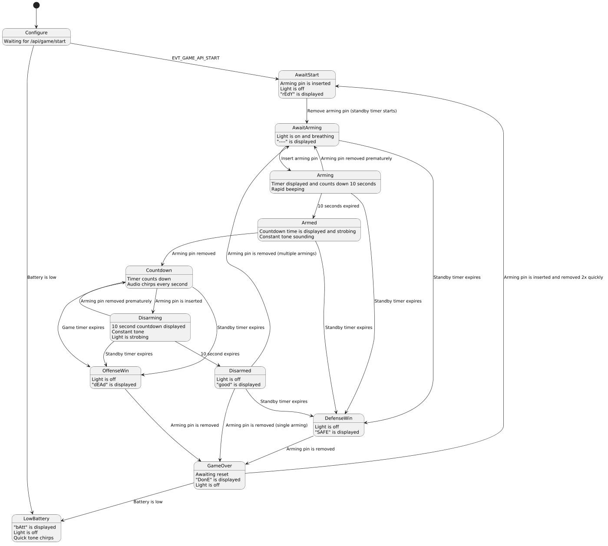

# Bio-Vial User Manual

**Bio-Vial by Brooklyn Tactical** is an objective prop for airsoft and milsim games. The **attackers** must carry the vial into the **defenders'** base, arm it, and start its countdown. The defenders must disarm it before the countdown hits zero.

Players only ever handle the **pin**. Referees set up each game from a phone or tablet.

## The Prop at a Glance

| Part | What it does |
|------|--------------|
| **Pin** | The players' only control. Inserting it and pulling it arms, starts and disarms the vial. |
| **Display** | Four-character screen that shows the prop's status and timers. |
| **Light bar** | Glows and pulses so players can tell from a distance that the vial is live. |
| **Speaker** | Beeps and tones during arming, disarming and the countdown. |
| **Battery** | Removable 3S 11.1 V LiPo stick battery, the same type used in airsoft guns. |

There is no power switch. Plug in the battery to turn the prop on, and unplug it to turn it off.

## Game Overview

1. The ref sets up the game and hands the vial to the attackers with the pin **inserted**.
2. On the start whistle, the attackers **pull the pin**. The game clock starts.
3. The attackers carry the vial to the defenders' base.
4. To **arm** it, they insert the pin and keep it in until arming finishes.
5. They then **pull the pin** to start the countdown.
6. To **disarm** it, the defenders insert the pin and keep it in until disarming finishes.
7. If the countdown hits zero first, the vial is released and the **attackers win**.
8. If the game time runs out first, the **defenders win**.

## Reading the Display

| Display | Meaning |
|---------|---------|
| `----` | Powering up, or the round is live and waiting for the attackers to arm the vial |
| `conF` | Powered up and waiting for the ref to set up the game from a phone |
| `SyS` | Admin mode (refs only, see [Admin Mode](#admin-mode)) |
| `rEdY` | Ready. Hand the vial to the attackers with the pin in |
| `-10-` | Arming or disarming in progress; shows the seconds left |
| `14:59` | Countdown running |
| `good` | Disarmed by the defenders |
| `dEAd` | Vial released: **attackers win** |
| `SAFE` | Game time ran out: **defenders win** |
| `DonE` | Round over. Alternates with `b- 87`, the battery level in percent |
| `bAtt` | Battery critically low. Swap the battery |

## For Players

### Attackers

1. Take the vial from the ref with the pin **inserted**. The display shows `rEdY`. **Do not pull the pin before the whistle.** Pulling it starts the round.
2. Move to your start position.
3. On the whistle, **pull the pin** and push to the defenders' base. The display shows `----`.
4. **Arm the vial:** insert the pin and keep it in. The display counts down, for example `-10-`, while the tones rise in pitch and the light bar pulses. If you pull the pin early, arming is cancelled and you must start again.
5. When arming finishes, the prop gives a steady warbling alarm and the light bar pulses rapidly. The vial is **armed**.
6. **Pull the pin** to start the countdown. The display shows the time remaining and the prop chirps every second.
7. Hold the objective until the countdown hits zero. The display shows `dEAd`: **you win**.

### Defenders

1. Hold your base and stop the attackers from arming the vial.
2. If the countdown is running, **disarm the vial:** insert the pin and keep it in. The display counts down, for example `-10-`, while the tones fall in pitch.
3. Keep the pin in until disarming finishes. **The countdown keeps running while you disarm.** If you pull the pin early, the vial goes back to its countdown and you must start disarming again.
4. When disarming finishes, the display shows `good`. The vial is **disarmed**.
5. If the game time runs out first, the display shows `SAFE`: **you win**.

## For Referees

### Power Up for a Game

1. Make sure the pin is **out**.
2. Plug in the battery. The display shows `----`.
3. Wait about 5 seconds for a short beep. The display then shows `conF`.

> **Important:** Inserting the pin within 5 seconds of power-up puts the prop into admin mode (`SyS`) instead. If that happens, unplug the battery and try again with the pin out.

### Connect Your Phone or Tablet

1. On your phone or tablet, open the Wi-Fi settings and join the prop's network. Use the network name and password set in [Admin Mode](#admin-mode).
2. The prop has no internet connection, so your device will usually say **"No internet"** or **"Sign in to network"**. Tap that notice to open the prop's control page.
3. If the page doesn't open by itself, open a web browser and go to **`http://my.milsim.prop/`**.

**Tip:** If your phone keeps dropping back to mobile data, choose **"Stay connected"** or **"Use this network without internet"** when asked, or temporarily turn off mobile data.

### Game Settings

| Setting | What it does                                                                                                                                          |
|---------|-------------------------------------------------------------------------------------------------------------------------------------------------------|
| **Countdown Time** | How long the defenders have to disarm once the countdown starts. 1–99 minutes.                                                                        |
| **Arm / Disarm Time** | How long the pin must stay in to arm or disarm. 5–99 seconds.                                                                                         |
| **Multiple Armings** | **Off:** a successful disarm ends the round. **On:** the vial can be armed and disarmed multiple times in the same round.                             |
| **Game Time** | Total round length, counted from the moment the attackers pull the pin on at sounding of the start whistle. 0–199 minutes; **0** means no time limit. |
| **Show Game Time** | Briefly flashes the remaining game time on the display while waiting for the attackers to arm the vial.                                               |

**Save** keeps the current settings as your defaults, and **Load** brings them back, so you don't have to re-enter them after every battery change.

### Start a Round

1. Enter the game settings for the round and press **Start Game**. The display shows `rEdY`.
2. Make sure the pin is **inserted**.
3. Hand the vial to the attackers and have them move to their start positions.
4. Blow the start whistle. The attackers pull the pin and the round is live.

### After the Vial Is Disarmed

When the display shows `good`, pull the pin:

- **Multiple Armings off:** the round ends and the display shows `DonE`.
- **Multiple Armings on:** the display goes back to `----` and the light bar stays on. The attackers can try to arm the vial again while game time remains.

After `dEAd` or `SAFE`, pull the pin to end the round. The display shows `DonE`.

### Reset for the Next Round

You can reset the prop without your phone:

1. While the display shows `DonE`, quickly **insert and pull the pin twice**: in, out, in, out. Each movement must take less than a second.
2. The display shows `rEdY`.
3. **Insert the pin**, then hand the vial back to the attackers.

The same settings are used again. To change them, or to restart a round at any time, connect your phone and press **Restart Game**.

### Admin Mode

Admin mode is for the field owner or head ref. It is mainly used to set or reset the game Wi-Fi password, and to check whether a part has stopped working.

**To enter admin mode:**

1. Plug in the battery making sure that **the pin is inserted within 5 seconds of power on**.
2. The prop beeps and the display shows `SyS`.
3. Join the open Wi-Fi network named **`BrooklynTactical-`** followed by a short code, for example `BrooklynTactical-<something>` where `<something>` is an alphanumeric number. No password is required.
4. Open the control page from the sign-in notice, or go to **`http://my.milsim.prop/`** in a browser.

The admin network is always open (no password) and always uses this name, even if the game Wi-Fi password has been forgotten. **Do not leave the prop in admin mode during a game.**

**Main pages:**

| Page | Use it to |
|------|-----------|
| **WiFi** | Set the game network name, password and channel. The password must be at least 8 characters. |
| **Diagnostics** | Test the light bar, display and speaker, and check the pin sensor with **Read Status**: `Detected` means the pin is in, and `Not Detected` means it is out. |
| **Mesh** | Advanced networking settings. Leave these alone unless instructed. |

New Wi-Fi settings take effect after a restart. To leave admin mode, press **Reboot** on the Diagnostics page or unplug the battery. Then power up again with the pin **out**.

## Battery and Care

- **Battery:** Use a charged 3S 11.1 V LiPo stick battery. Unplug it when the prop is not in use.
- **Low battery:** The battery level appears on the `DonE` screen between rounds. If the display shows `bAtt`, the prop stops working. Swap in a charged battery and power up again.
- **LiPo safety:** Follow standard LiPo safety. Don't over-discharge or damage the battery, and charge and store it according to the manufacturer's instructions.
- **Weather:** The prop is splash- and mist-resistant but **not waterproof**. Do not submerge it or leave it in heavy rain.
- **Sunlight:** Safe to use in direct sunlight.
- **Impacts:** The polycarbonate and PETG body is impact-resistant, but direct hits at close range can damage it. Consider making the prop a no-shoot target in your field rules.

## Troubleshooting

| Problem | What to do |
|---------|------------|
| The display shows `SyS` when you wanted to run a game | The pin was inserted during power-up. Unplug the battery, remove the pin, and power up again. |
| Your phone can't find the prop's network | Make sure the display shows `conF`, `rEdY`, or a game screen, not `----` during power-up. Check the network name in admin mode. |
| You forgot the game Wi-Fi password | Enter admin mode and set a new password on the **WiFi** page. |
| The control page doesn't open | Open a browser and go to `http://my.milsim.prop/`. Turn off mobile data if your phone keeps leaving the prop's network. |
| Inserting the pin does nothing | Use **Diagnostics > Read Status** in admin mode to check the pin sensor. |
| The pin-reset trick doesn't work | Make sure the display shows `DonE`, and move the pin faster. Each in or out must take less than a second. You can also press **Restart Game** on your phone. |
| The display shows `bAtt` | Swap in a charged battery and power up again. |

## Game Flow Map

